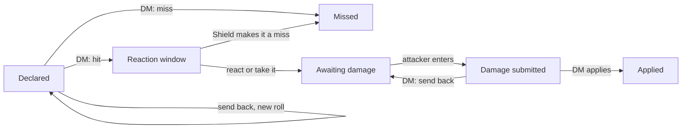

# Combat D&D Design Doc

> Snapshot of the living design doc as of 2026-11-21. The editable version, with comments, is at
> https://claude.ai/artifact/EvjGJzwvnNzExE1oMbCCAH. Update this file when the design changes.

## Overview

Combat D&D is a web app that tracks D&D 5e combat for our remote group: one DM and about 8 players, each on their own laptop. Everyone sees the same live initiative list; the DM sees everything, and players see their own options plus what their characters would know.

Goals:

- Nobody loses track of initiative, HP, conditions or whose turn it is.
- A player's turn is a short back-and-forth with the DM: declare, DM calls it, enter damage, DM applies.
- Turns go faster because players can see their options and plan ahead while they wait.
- Characters carry over between sessions, and the DM can prepare encounters ahead of time.

Players roll physical dice and type in totals. The app never rolls for anyone.

The [clickable mockup](https://claude.ai/artifact/2YbcoLEwtTzEnpHRycCKpn) shows the combat screen with the DM and player views side by side.

## Principles

These four rules decide most design questions.

1. **Track, don't enforce. The DM rules.** The app records what happened and shows hints. It never blocks an action because a resource looks used. It automates only fixed numbers, like HP, AC or Shield's +5. Character builds, positioning and judgment calls are entered by players and confirmed by the DM.
2. **Hidden information is enforced on the server.** Players never receive enemy HP, AC, private conditions or hidden combatants. The server builds a filtered view for each viewer, so nothing is hidden only in the UI.
3. **Everything that happens is an event.** Each change is appended to an event log. The combat log, undo and audit history all come from it.
4. **Rules are pure functions.** `decide` (may this actor do this now?) and `evolve` (apply one event) have no database or HTTP code, so every rule can be unit tested.

## Scope

Version 1 covers one complete fight, from prep to the last hit. Later work makes it richer, not different.

| Area | Version 1 | Later |
| --- | --- | --- |
| Campaign | Join link, DM approves players, rejoin on a new laptop | Real accounts |
| Characters | Player-created, persistent HP, attack presets with default costs, reactions with modes | Spell slots, full sheets, level-up help |
| Monsters | Templates with HP, AC, speed, attacks, Multiattack, reactions | Import from the free 5e SRD |
| Encounters | Prep ahead, hidden enemies, DM notes, duplicate | Maps and positions |
| Initiative | Players submit their own rolls, DM fills enemies and reorders | |
| Turns | Attack and spell flow, reactions, send back, standard actions, resource tracking, undo | Multi-target spells (Fireball, Bless), concentration checks |
| Planning | Turn plans, Ready badge, early rolls (DM setting), automatic reactions | |
| Views | DM, player, shared feed and log | A read-only spectator link |

## User flows

### Joining a campaign

1. The DM creates a campaign and shares the join link (e.g. `/join/K7QX2`) in the group chat.
2. A player opens the link, types a name, and waits in a lobby.
3. The DM approves or denies. Approval sets a cookie in that browser.
4. On a new laptop, the player opens the same link, picks "I'm returning as…", and the DM approves again.

The DM can remove a player or regenerate the join code.

### Characters

Players create their own characters: name, max HP, AC, speed, initiative bonus, attack presets and reactions. The DM can edit any character, create one for a player, or create DM-controlled NPC allies. HP lives on the character, so damage carries over between fights and sessions.

### Encounter prep and starting combat

1. Before the session, the DM builds encounters: enemies from templates ("Goblin × 4" becomes Goblin 1–4), one-off enemies, hidden reinforcements, DM-only notes and optionally pre-rolled enemy initiative.
2. At the table, the DM presses **Start combat**. Every active party member is added.
3. Each player's screen asks for their initiative roll. The DM fills in any missing enemy rolls.
4. The DM presses **Begin round 1**. The list sorts by initiative, and the DM can drag to break ties.

The DM can add or reveal combatants at any point during the fight.

### A turn

The current combatant's bubble expands for everyone. Only its controller and the DM get the controls.

- **Attack** or **Spell**: pick a preset (it fills in what it uses), pick a target from the grouped list or by clicking a bubble, choose Normal, Advantage or Disadvantage, flag a natural 20 or 1, and enter the roll.
- **More actions**: Dash, Disengage, Dodge, Help, Hide, Ready, Search, Use an Object, plus the character's own options such as Second Wind.
- Action, Bonus action, Reaction and movement mark themselves from declarations. Clicking them is only for corrections.
- **End turn**: the player ends their own turn. The DM can always go to the next or previous turn.

### The attack flow

1. **Declared**: the DM sees the roll against the target's AC, condition hints, and any enemy reaction (for example Parry +2 AC).
2. The DM picks **Hit**, **Miss** or **Send back** (with a reason, such as "Roll with disadvantage").
3. **Reaction window**: on a hit against a party member who still has a reaction, that player is asked whether to react. Shield recalculates and can turn the hit into a miss. The DM can skip the window.
4. **Damage**: the attacker enters the total and type. A natural 20 reminds them to roll the dice twice. On enemy attacks, the DM's entry applies directly.
5. **Confirm**: the DM can adjust the number, then applies it or sends it back.



A miss or a Shield ends the attack early. A send-back returns the step to the attacker without losing the thread. The reaction window is skipped when the target has no reaction left or every reaction is set to Never ask.

At any time outside your turn, **Use reaction** on your own bubble logs an opportunity attack or a similar reaction.

### Planning a turn

While waiting, a player opens **Plan my turn**:

- Options are grouped by Action, Bonus and Free and added to the plan in order.
- Each step gets a target and, if the DM allows early rolls, a roll and roll mode.
- **Mark ready** shows a Ready badge to everyone. Only the owner sees the plan itself.
- Each reaction gets a mode: Always ask, Never ask, or Use it when it turns a hit into a miss (never on a natural 20).

When the turn starts, the plan becomes a checklist. A step with an early roll is one click; one without opens the composer prefilled. If a target has dropped, the step warns instead of failing. The DM still calls every hit. A plan clears when the turn ends.

## Data model

Postgres is the single source of truth. The server caches each active encounter in memory and rebuilds it from its events when needed. The full schema is in `backend/src/main/resources/db/migration/V1__init.sql`.

| Table | Key columns | Notes |
| --- | --- | --- |
| `campaign` | name, join_code, dm_token_hash, allow_early_rolls | One per group |
| `player` | campaign_id, display_name, token_hash, status (PENDING, APPROVED, REMOVED) | No passwords in version 1 |
| `character` | player_id (null = DM-controlled), name, kind (PC, NPC), max_hp, current_hp, temp_hp, ac, speed, initiative_bonus, conditions, attacks_per_action, attack_presets, reactions | HP lives here so it carries over |
| `monster_template` | name, max_hp, ac, speed, initiative_bonus, attack_presets, multiattack, reactions, notes | Reused across encounters |
| `encounter` | name, status (PREPARING, ROLLING_INITIATIVE, ACTIVE, ENDED), round, current_combatant_id, version, notes, auto_add_party | `version` guards against conflicting edits |
| `combatant` | encounter_id, side (PARTY, ENEMY, NEUTRAL), character_id or monster_template_id, name, initiative, sort_order, hp and ac (monsters only), conditions, hidden, defeated, ac_bonus, action_used, bonus_used, reaction_used, movement_used, dashed, attacks_this_turn | One row per participant |
| `encounter_event` | encounter_id, seq, actor_role, actor_id, type, payload, undone, created_at | Append-only log |
| `turn_plan` | encounter_id, combatant_id, steps, note, ready, updated_at | Outside the event log on purpose |

Shapes stored as JSON:

- **Attack preset**: `{name, kind: ATTACK | SPELL | OTHER, defaultCost: ACTION | BONUS | REACTION | FREE, note}`, e.g. Shortsword, Free, "Nick".
- **Reaction**: `{name, acBonus?, halveDamage?, mode: ASK | NEVER | AUTO_IF_TURNS_MISS}`.
- **Condition**: `{name, private}`. Private conditions are only meaningful on enemies.
- **Plan step**: `{kind, label, cost, note, targetId, roll, rollMode, status}`.

### What each viewer receives

| Data | DM | Player |
| --- | --- | --- |
| Party HP, AC, conditions, resources | Yes | Yes |
| Enemy name and initiative | Yes | Yes |
| Enemy HP, AC, attacks | Yes | Never sent |
| Enemy conditions | All | Public ones only |
| Hidden combatants | Yes | Not until revealed |
| Defeated enemies | Yes | Shown greyed out |
| Enemy reactions in the log | Name and AC change | Name only |
| Turn plans | Ready flag only | Own plan in full; others' Ready flag |

## Backend

The backend is Kotlin on Spring Boot 4 (Spring MVC, Java 21 virtual threads), with Spring JDBC and Flyway on Postgres. Commands come in over REST, and updates go out over Server-Sent Events (SSE).

### Combat rules

```kotlin
fun decide(state: EncounterState, cmd: Command, actor: Actor): Decision
fun evolve(state: EncounterState, event: Event): EncounterState
fun viewFor(state: EncounterState, viewer: Actor): EncounterView
fun hintsFor(attacker: Combatant, target: Combatant, viewer: Actor): List<Hint>
```

- `decide` checks only structure: whose turn it is, what is pending, who controls which combatant. It never checks resource limits.
- Current state is `events.fold(initial, ::evolve)`. Undo marks the last event undone and replays.
- Commands: `DeclareAttack` (preset, target, cost, cost note, roll, roll mode, natural, early), `ResolveAttack`, `EnemyReact`, `SendBack`, `Resubmit`, `React`, `SkipReaction`, `SubmitDamage`, `ApplyDamage`, `UseReaction`, `UseStandardAction`, `UseResource`, `SetCondition`, `EditCombatant`, `Reorder`, `AddCombatant`, `RevealCombatant`, `StartInitiative`, `SubmitInitiative`, `BeginCombat`, `NextTurn`, `PreviousTurn`, `Undo`.
- Attack states: `DECLARED`, `RESUBMIT`, `REACTION_WINDOW`, `AWAITING_DAMAGE`, `DAMAGE_SUBMITTED`, then `APPLIED` or `MISSED`.
- Automatic reactions: when the DM calls a hit, `decide` also emits the target's `AUTO_IF_TURNS_MISS` reaction if its AC bonus would turn the hit into a miss and the roll is not a natural 20. `evolve` then applies it like any other reaction.

### API

| Method and path | Purpose |
| --- | --- |
| `POST /api/campaigns` | Create a campaign; sets the DM cookie |
| `POST /api/campaigns/join` | Join or rejoin with the code |
| `GET /api/campaigns/{id}/lobby/stream` | SSE so a waiting player sees approval at once |
| `POST /api/campaigns/{id}/players/{pid}/approve`, `/deny`, `/remove` | DM manages players |
| `POST /api/campaigns/{id}/join-code/rotate` | New join code |
| `GET, POST, PUT, DELETE /api/campaigns/{id}/characters` and `/monster-templates` | CRUD |
| `POST /api/campaigns/{id}/encounters`, `/encounters/{id}/duplicate` | Prep |
| `POST /api/encounters/{id}/combatants`, `/combatants/party` | Add combatants |
| `POST /api/encounters/{id}/commands` | Every combat command, with `expectedVersion` |
| `GET /api/encounters/{id}/state` | This viewer's filtered state |
| `GET /api/encounters/{id}/stream` | SSE: the filtered state after every change |
| `GET, PUT /api/encounters/{id}/plans/{combatantId}` | Turn plans (plain CRUD, no version bump) |

### Request lifecycle

1. Resolve the actor from the cookie.
2. Lock the encounter (one in-memory lock per encounter).
3. Reject with 409 if `expectedVersion` is stale.
4. Run `decide`; reject with 400 or 403 and a reason.
5. In one transaction, insert the events, bump the version and write character HP.
6. Fold the events into the cached state, unlock, then broadcast.

Broadcasting computes `viewFor` once per viewer and sends the whole snapshot (a few KB), so the client never merges diffs. A 15-second heartbeat keeps connections open through proxies, and the browser reconnects on its own.

This design assumes one server instance. If that ever changes, Postgres `LISTEN/NOTIFY` can fan out broadcasts without changing the rest.

## Frontend

The frontend is one React app, served by Spring as static files, so there is a single deployable and no cross-origin cookie problems.

| Concern | Choice |
| --- | --- |
| Build | Vite, React, TypeScript |
| Routing | React Router |
| API types and client | Generated from Spring's OpenAPI spec with openapi-typescript and openapi-fetch |
| CRUD pages | TanStack Query |
| Live combat state | A `useEncounter` hook over `EventSource` |
| Components | Tailwind and shadcn/ui (Radix), restyled to our design tokens |
| Drag to reorder | dnd-kit (DM only) |

### Routes

- `/join/:code`: join or rejoin, then the lobby.
- `/c/:campaignId`: campaign home. The DM manages players, characters, templates and encounters; players manage their characters and join the active fight.
- `/c/:campaignId/encounters/:id`: encounter prep (DM).
- `/combat/:id`: the combat screen, rendered by role.

### Combat screen components

- `CombatHeader`: round, whose turn, and DM controls (previous, next, undo, early rolls, end combat).
- `InitiativeFeed` of `CombatantBubble`s: enemies left, party right, in initiative order. Collapsed bubbles show HP and AC where visible, conditions, Ready and reaction status.
- `TurnPanel` (the current bubble, expanded): `ResourceBar`, `TurnThread`, `InteractionCard`, `PlanChecklist` and `ActionComposer` with `TargetPicker` (grouped, filterable, last target first).
- `PlanEditor` on your own bubble outside your turn.
- `ReactionPrompt`, `InitiativePhase`, and a `DmDrawer` for adding, revealing and editing.

### State

The screen renders purely from the latest snapshot. Commands are sent with the snapshot's version, with no optimistic updates: a round trip takes around 100 ms. A 409 shows "The table changed. Check and try again." A 400 or 403 shows the server's reason inline. Rules live only on the server; the client only shows hints that the server computed.

## Visual design

The layout and interactions are a modern chat app; the fantasy shows only in type, color and a few ornaments. Dark is the default, with a light theme toggle. The [mockup](https://claude.ai/artifact/2YbcoLEwtTzEnpHRycCKpn) is the reference, and the tokens live in `frontend/src/styles/tokens.css`.

| Token | Dark | Light | Used for |
| --- | --- | --- | --- |
| bg | #14161B | #F3EDE0 | Page |
| surface | #1C1F26 | #FBF8F1 | Panels, collapsed bubbles |
| text | #ECE6D8 | #2A2620 | Body text |
| gold | #D4A64A | #9E7418 | Current turn, primary buttons, DM label |
| party | #3F8C96 on #1B3239 | #2A6C75 on #DDEBEC | Party bubbles (right) |
| enemy | #B5473D on #361E21 | #9E3A31 on #F3E0DB | Enemy bubbles (left) |
| react | #A18FD8 | #6550A8 | Reactions |
| HP high, mid, low | #6DBE7A, #E0A33A, #D9534F | #3B8A4A, #B07610, #B73A35 | HP bars, hits, damage |

- **Type**: Cinzel only for the logo, names and round dividers; Inter for everything else, with tabular numbers.
- **Feed**: one column in initiative order. Bubbles are at most 72% wide with one flat corner on their side. The current turn has a gold border and glow and expands to show its thread.
- **Side is never shown by color alone**: alignment plus a shield or skull icon.
- **Action economy by shape**: ● Action, ▲ Bonus, ■ Reaction. A used resource is dimmed and struck through.
- **Thread**: player messages on the right, DM messages on the left with a gold DM tag, damage as a large red number, pending steps as a card with a gold edge.
- **Motion**: about 200 ms expands, new messages rise in, a short shake on damage; all off under reduced motion.
- **DM shortcuts**: H hit, M miss, Enter apply, N next turn, U undo.

"D&D" is a Wizards of the Coast trademark. The name is fine for a private group app; rename it before any public release.

## Infrastructure

One Docker image runs on one Fly.io machine with Neon Postgres, for an estimated $5–7 a month. Prices are approximate; check current pricing before committing.

| Piece | Choice | Approximate cost |
| --- | --- | --- |
| App | Fly.io, 1 shared-CPU machine with 1 GB RAM, in the region nearest the group | $5–7/month |
| Database | Neon serverless Postgres | Free tier |
| Domain | `combat-dnd.fly.dev` with TLS included | $0 |
| Errors | Sentry, frontend and backend | Free tier |
| Backups | Nightly `pg_dump` to Cloudflare R2, kept 30 days | Free tier |

Railway is the fallback if we'd rather manage everything from a dashboard; the same Docker image runs there.

### Build and deploy

- The Dockerfile has three stages: Node builds the frontend, Gradle builds the jar with the frontend in `static/`, and the image runs on a Java 21 JRE.
- Flyway migrations run when the app starts.
- GitHub Actions on every pull request: backend tests, frontend lint and build. Planned: Testcontainers Postgres tests and a check that the generated API types are up to date.
- On merge to main: build the image and `flyctl deploy` (commented out in `ci.yml` until the Fly app exists).
- Locally: `docker compose up` for Postgres, `./gradlew bootRun`, and `npm run dev` with `/api` proxied to Spring.

### Settings that matter

- Exactly one machine (`fly scale count 1`), always running (`min_machines_running = 1`), because state, locks and SSE connections live in memory.
- SSE: 15-second heartbeat and no response buffering on the stream endpoint.
- A deploy restarts the server. Browsers reconnect within seconds and state is rebuilt from events, but the blip is visible, so don't deploy mid-session.

### Security

- Tokens are 32 random bytes, stored hashed. Cookies are `HttpOnly; Secure; SameSite=Lax`.
- Every POST requires an `X-Requested-With` header against CSRF.
- The join endpoint is rate limited, on top of DM approval.
- Secrets go in `fly secrets`, never in the repo.

## Roadmap and open questions

Build order, each step usable on its own:

1. Repo scaffold: Gradle backend, Vite frontend, Docker image, CI, the database schema. **Done.**
2. Combat rules: `decide`, `evolve`, `viewFor` and `hintsFor`, with unit tests. **Mostly done**; still to add: undo, initiative phase, HP and condition edits, add and reveal combatants, previous turn.
3. Encounter service and API: commands, version checks, persistence, SSE.
4. Combat screen: the feed, turn panel, attack flow and DM controls.
5. Campaign, join and lobby, characters, monster templates, encounter prep, initiative phase.
6. Turn planning and reaction modes.
7. Deploy to Fly.io and run a test session with the group.

Open questions:

- [ ] Should multi-target spells (Fireball, Bless) be in version 1? They need a checkbox target list and a per-target save on the DM's card.
- [ ] Should early rolls default to on or off for a new campaign?
- [ ] What should players see when an enemy is hidden but attacks them?
- [ ] Do we want concentration tracking soon after version 1?
