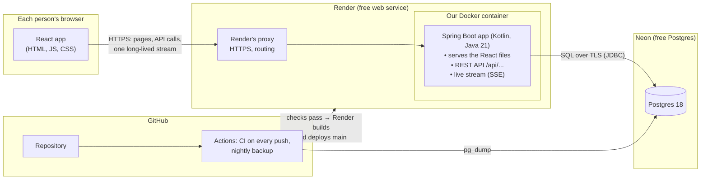
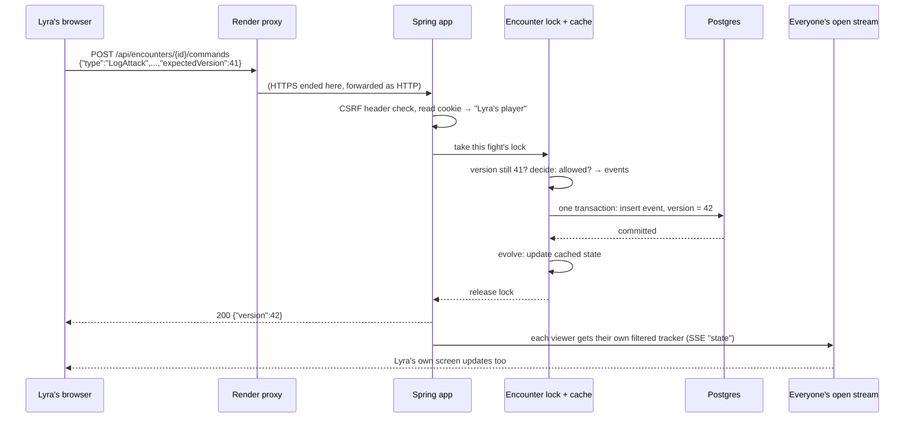

# Chapter 0: The big picture

Combat D&D is a small but complete web system: a browser app, an API server, a database, live updates
to every screen, sign-in without passwords, automated builds, deploys and backups. About 4,300 lines of
Kotlin, 3,500 of TypeScript, 1,300 of CSS and six database migrations.

This chapter gives you the map. Every later chapter zooms into one part of it.

## 1. The pieces and where they run



There are only **three running things**:

1. **The browser app.** React code compiled into plain JavaScript files. It draws the screens and talks
   to the server. It holds no important state of its own: everything it shows came from the server.
2. **The server.** One Spring Boot process in one Docker container on Render. It serves the browser app's
   files, answers the API, keeps a live connection open to every screen, and enforces every rule.
3. **The database.** Postgres on Neon. The source of truth: if the server restarts, everything is rebuilt
   from here.

Everything else (GitHub Actions, Render's build system, the backup job) only runs when something
happens: a push, a merge, the nightly timer.

One detail worth noticing early: **the server serves the frontend itself.** The React build output is
copied into the server's jar, so the site and the API share one address
(`https://combat-dnd.onrender.com`). That means no CORS configuration and cookies just work, at the cost
of having to redeploy the server to change the UI. Chapter 8 shows how the Dockerfile does it.

## 2. The folder map

```
combat-dnd/
├── backend/                         The server (Kotlin + Spring Boot), built with Gradle
│   ├── build.gradle.kts             Dependencies and build settings
│   └── src/
│       ├── main/kotlin/app/combatdnd/
│       │   ├── CombatDndApplication.kt   Starts the app (and reads DATABASE_URL)
│       │   ├── encounter/                FIGHTS: the heart of the app
│       │   │   ├── domain/   Pure rules, no database or web: Model, Commands, Events,
│       │   │   │             Decide (is it allowed?), Evolve (what changes?), View (who sees what)
│       │   │   ├── app/      EncounterService (locks, cache, undo), EncounterRepository (SQL),
│       │   │   │             EventCodec (events ⇄ JSON), EncounterHub (live streams)
│       │   │   ├── api/      EncounterController (HTTP endpoints) and the JSON shapes (DTOs)
│       │   │   └── prep/     Setting fights up: roster, start, begin, end
│       │   ├── campaign/     Campaigns, players, joining, characters, NPCs, monsters, D&D Beyond links
│       │   ├── auth/         Who is asking: cookies (Session) and ActorResolver
│       │   ├── portrait/     Uploading, shrinking and serving portraits
│       │   ├── web/          Cross-cutting web bits: errors → JSON, CSRF check, page forwarding
│       │   └── dev/          Sample data, only in development
│       ├── main/resources/
│       │   ├── application.yml           Settings (database, port, pool, health check)
│       │   └── db/migration/V1…V6        The database schema, one change per file (Flyway)
│       └── test/kotlin/…                 Rules tests and API tests
├── frontend/                        The browser app (React + TypeScript), built with Vite
│   ├── index.html                   The one HTML page (React draws everything inside it)
│   └── src/
│       ├── main.tsx, App.tsx        Start-up and the list of pages (routes)
│       ├── api/                     Talking to the server: client.ts, and types mirroring the DTOs
│       ├── pages/                   One file per page: Home, Join, Campaign, Prep, Combat, DM sign-in
│       ├── combat/                  The tracker: useEncounter (live state), Tracker, LogPanel, …
│       └── styles/                  Colors (tokens.css) and shared controls (ui.css)
├── docs/                            Design doc, deploy guide, session checklist, this guide
├── scripts/dev.sh                   One command to run everything locally
├── docker-compose.yml               Local Postgres for development
├── Dockerfile                       How the production image is built (frontend → jar → runtime)
├── render.yaml                      Render's settings for the live site
└── .github/workflows/               ci.yml (tests on every push), backup.yml (nightly pg_dump)
```

The backend's `encounter/` package shows the shape the whole app follows, in **layers**. Each layer only
talks to the one below it:

| Layer | Folder | Knows about | Doesn't know about |
| --- | --- | --- | --- |
| **API** | `encounter/api` | HTTP, JSON | SQL, locks |
| **Application** | `encounter/app` | Transactions, locks, caching, live streams | HTTP |
| **Domain** | `encounter/domain` | The rules of the tracker | Databases, HTTP, Spring: it's plain Kotlin |

That last row is the most important design decision in the codebase, and Chapter 2 is about it.

## 3. One click, end to end

Lyra's player is on their turn. They pick the Goblin Boss, choose **Hit**, type `9` and press **Log**.
Within about a second, every screen at the table shows the boss lose 9 HP. Here is everything that
happens in between.



### Step 1: the button (browser)

`frontend/src/combat/LogPanel.tsx` checks the form, then sends a **command**: a small object describing
what the person wants to happen.

```ts
const ok = await act({ type: 'LogAttack', attackerId: attacker.id, targetId, hit, damage: dmg })
```

Notice what it does *not* do: it doesn't subtract 9 from the boss's HP on screen. The browser never
changes the tracker itself. It asks, and waits for the server to tell everyone the new truth. (This is
called having **no optimistic updates**; the trade-off is a fraction of a second of delay in exchange
for never showing something the server then refuses.)

### Step 2: the request (browser → network)

`frontend/src/combat/useEncounter.ts` turns the command into an HTTP request:

```ts
const send = useCallback((command: Command) => post('commands', { ...command, expectedVersion: version.current }), [post])
// …
const res = await fetch(`/api/encounters/${encounterId}/${path}${asParam}`, {
  method: 'POST',
  credentials: 'include',                                  // send the sign-in cookie
  headers: { 'Content-Type': 'application/json', 'X-Requested-With': 'combat-dnd' },
  body: body ? JSON.stringify(body) : undefined,
})
```

Three things ride along with every command:

- **`expectedVersion`**: "the last version of the tracker I saw". If someone else changed the fight in
  the meantime, the server refuses with **409** instead of applying a command based on stale information.
  This is **optimistic concurrency control** (Chapter 3).
- **The cookie** `cdnd_pl_<campaign>`: a random secret that says *who* this browser is (Chapter 5).
- **`X-Requested-With`**: a custom header that another website can't make your browser send, which
  blocks cross-site request forgery (Chapter 5).

### Step 3: Render's proxy

The request reaches Render over HTTPS. Render's proxy **terminates TLS** (decrypts it), then forwards plain
HTTP to our container on the port it gave us in the `PORT` environment variable. It adds headers like
`X-Forwarded-Proto: https` and `X-Forwarded-For: <your IP>`, which our code reads to decide whether cookies
should be `Secure` and to rate-limit join attempts per person (Chapters 5 and 8).

### Step 4: Spring receives it

Spring Boot runs an embedded web server (Tomcat) inside our process. With **virtual threads** turned on
(`spring.threads.virtual.enabled: true`), each request gets a cheap Java 21 virtual thread, so thousands of
open live streams don't need thousands of expensive OS threads.

Before our controller runs, an **interceptor** checks the CSRF header (`web/WebConfig.kt`):

```kotlin
if (request.method in safe || !request.getHeader("X-Requested-With").isNullOrBlank()) return true
response.status = HttpServletResponse.SC_FORBIDDEN
```

Then Spring matches the URL to a method and turns the JSON body into a Kotlin object (Jackson does this,
using the `"type"` field to pick which command class to build):

```kotlin
// encounter/api/EncounterController.kt
@PostMapping("/commands")
fun command(@PathVariable id: UUID, @RequestBody body: CommandRequest, request: HttpServletRequest): VersionResponse =
    VersionResponse(service.handle(id, actors.resolve(request, id), body.toCommand(), body.expectedVersion))
```

`actors.resolve(...)` reads the cookie, hashes it, and looks it up: the answer is an **Actor**, either
`Actor.Dm` or `Actor.Player(id)`. From here on, nothing cares about cookies or HTTP.

### Step 5: the lock, the version check, the rules

`encounter/app/EncounterService.kt` is where the real work happens:

```kotlin
fun handle(id: UUID, actor: Actor, command: Command, expectedVersion: Long?): Long = publish(id) { loaded ->
    requireRunning(loaded)
    if (expectedVersion != null && expectedVersion != loaded.revision) throw StaleVersion()
    commit(id, loaded, actor, decideOrThrow(loaded.state, command, actor))
}
```

- **`publish(id) { … }`** takes a lock that belongs to *this fight only*, so two commands for the same
  fight run one after another, while different fights don't wait for each other.
- **`loaded`** is this fight's current state, kept **in memory**. The first time a fight is touched after
  a restart, it's rebuilt by replaying its events from the database (Chapter 2).
- **`decide(state, command, actor)`** is a pure function in `domain/Decide.kt`. It answers "is this
  allowed, and if so what happened?" For our click it checks: is it Lyra's turn? is she yours? is the
  target visible to you? is Lyra above 0 HP? Then it returns an **event**: a fact in the past tense,
  `AttackLogged(id = a17, round = 3, attacker = lyra, target = boss, hit = true, damage = 9)`.

### Step 6: saving it (Postgres)

```kotlin
tx.executeWithoutResult {
    if (events.isNotEmpty()) repo.append(id, batch = revision, actor = actor, events = events)
    repo.setVersion(id, revision)
    …
}
```

One **transaction**: the event row is inserted into `encounter_event` *and* the fight's version is bumped,
or neither happens. The event is stored as JSON (`payload jsonb`). Notice what's **not** saved: the boss's
new HP. A fight's current state is never stored directly; it's always *computed* from its events. That's
**event sourcing**, and Chapter 2 explains why it makes undo, history and testing so simple.

Only after the database confirms does the in-memory state move forward:

```kotlin
val next = events.fold(loaded.state, ::evolve)   // apply the event: boss HP 30 → 21
loaded.state = next
loaded.revision = revision                        // 41 → 42
```

### Step 7: telling everyone (live stream)

Every open tracker holds one long-lived HTTP connection: `GET /api/encounters/{id}/stream`, a
**Server-Sent Events** stream. After the lock is released, the hub sends each viewer *their own* version
of the tracker:

```kotlin
// encounter/app/EncounterHub.kt
fun broadcast(id: UUID, state: EncounterState, header: Header) {
    subscribers[id]?.forEach { send(it, viewFor(state, it.actor).toDto(header)) }
}
```

`viewFor` (`domain/View.kt`) is the privacy filter: the DM gets everything; players get the same list
minus hidden enemies, with enemy AC and HP replaced by nothing. So a player's browser **never receives**
an enemy's HP, not even hidden in the page. Each viewer gets the *whole* tracker (a few KB), not a
"diff", so a browser can never get out of step: any message fully replaces what it had.

Broadcasting happens *outside* the lock on purpose: one laptop on slow Wi-Fi shouldn't hold up everyone
else's next command.

### Step 8: the screens update (browser)

Back in `useEncounter.ts`, every browser's stream listener receives the new snapshot:

```ts
source.addEventListener('state', (e) => {
  const next: EncounterView = JSON.parse((e as MessageEvent<string>).data)
  version.current = Math.max(version.current, next.version)
  setView((prev) => (prev && prev.version > next.version ? prev : next))
})
```

`setView` hands the new data to React, which works out which parts of the page changed and updates
just those. The boss's HP bar slides from 30 to 21, and Lyra's "last turn" shows *Hit Goblin Boss · 9*,
on every screen, including Lyra's own: her browser learned the result the same way everyone else did.

Meanwhile the POST from step 2 also returned `{"version": 42}`, so if Lyra's player immediately presses
**End turn**, that command carries version 42 even if the stream message hasn't arrived yet.

### What could go wrong, and what happens

| Situation | What the system does |
| --- | --- |
| The DM changed something a moment earlier | Version mismatch → **409**, "The table changed. Check and try again." Nothing is applied. |
| It isn't Lyra's turn, or she's at 0 HP | `decide` refuses → **403/400** with a reason shown on screen |
| Someone's Wi-Fi drops | Their stream breaks; the browser reconnects by itself and receives a fresh full snapshot |
| The server restarts mid-session (a deploy) | Streams close, browsers reconnect, the fight is rebuilt from its events. Nothing lost. |
| Postgres is unreachable | The transaction fails → the command is refused; memory never moved ahead of the database |

## 4. The ideas you'll meet in every chapter

- **The server decides everything.** The browser asks and displays. Rules and privacy are enforced in
  one place, so a modified browser can't cheat.
- **Events are the truth.** Fights are stored as what happened, not as current numbers.
- **Pure core, impure shell.** The rules are plain functions with no database or web code, wrapped by
  layers that handle the messy parts (locks, SQL, HTTP).
- **Every viewer gets a full, filtered snapshot.** Simple to reason about, impossible to drift.
- **One server.** The lock, cache and live streams live in one process's memory. That's what makes the
  design simple, and it's the first thing that would change if the app had to grow (Chapter 9).

## Try this

Run `./scripts/dev.sh`, open the dev fight it prints as DM (`…?as=dm`) in one window and as a player
(`…?as=player:…`) in another.

1. **Watch the stream.** In the player window open DevTools → **Network**, click the `stream` request,
   then the **EventStream** tab. Press **Next turn** as the DM and watch a `state` message arrive. Expand
   it and find an enemy: `"ac": null, "hp": null`. That's `viewFor` at work.
2. **See a command.** In the DM window's Network tab, log an attack and click the `commands` request.
   Look at the request body (the command and `expectedVersion`) and the response (the new version).
3. **Cause a 409.** With the DM window open, run this (replace the version with something old, like 1):

   ```bash
   curl -i -X POST 'http://localhost:8080/api/encounters/00000000-0000-4000-8000-0000000000a1/commands?as=dm' -H 'Content-Type: application/json' -H 'X-Requested-With: curl' -d '{"type":"NextTurn","expectedVersion":1}'
   ```

   You'll get `409 Conflict`. Remove `"expectedVersion":1` and run it again: it succeeds, and the DM
   window moves to the next turn by itself.
4. **Skip the CSRF header.** Run the same command without `-H 'X-Requested-With: curl'`: **403**.
5. **Read the event log.** Open the local database:

   ```bash
   docker compose exec db psql -U combat combat_dnd -c "select seq, batch, actor_role, type, payload from encounter_event order by seq desc limit 5"
   ```

   Your attack is there as JSON. There is no "HP" column anywhere for fights: it's all computed.

**Next:** Chapter 1, the data: every table, how migrations change the schema safely, and why the
database never sees a password or a sign-in secret.
